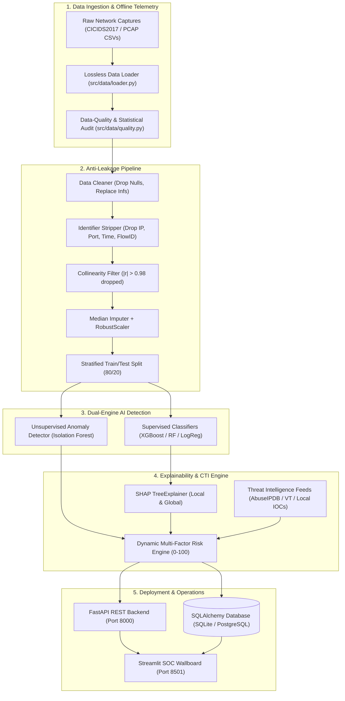
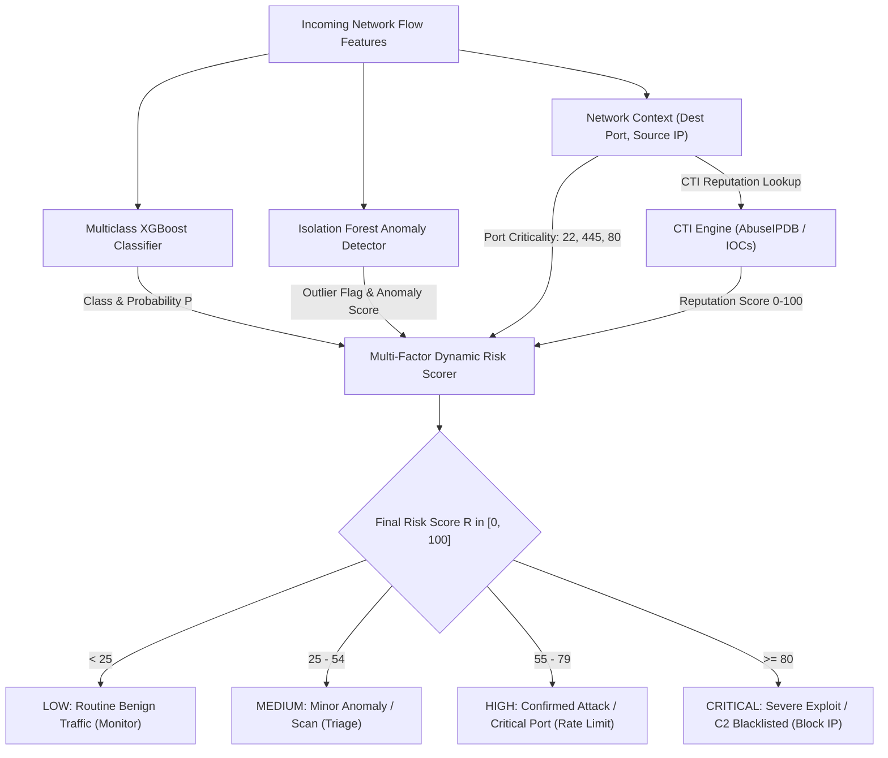
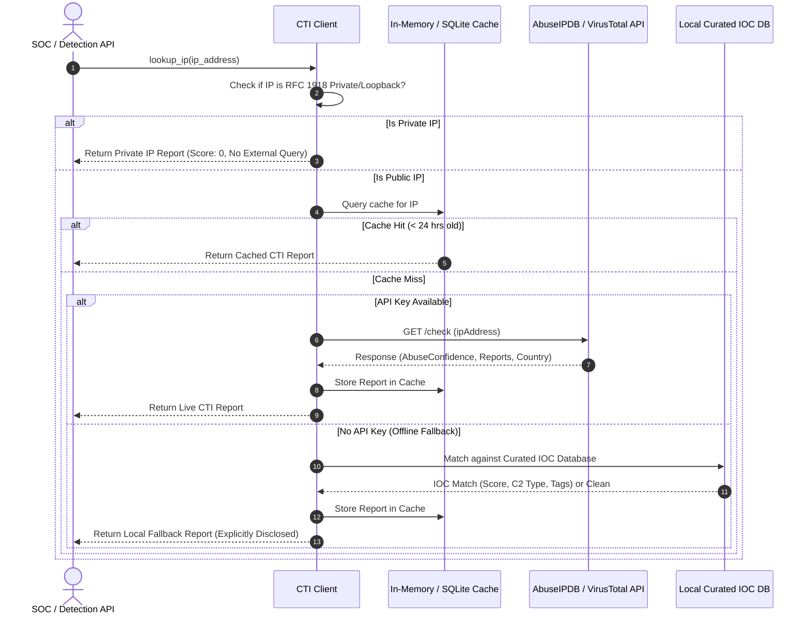
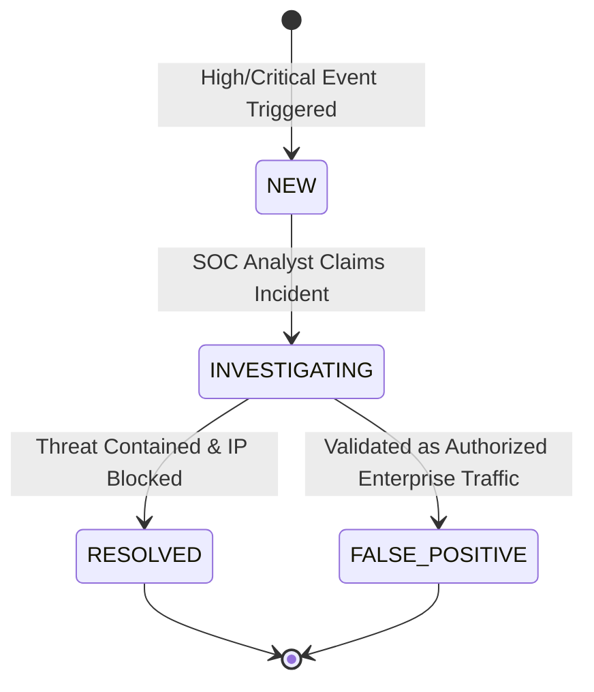

# Argus NIDS: System Architecture & Data Flow

This document details the architectural topology, data pipelines, explainability framework, and operational workflows of the **AI-Powered Network Intrusion Detection & Cyber Threat Intelligence System (Argus NIDS)**.

---

## 1. High-Level System Architecture

---

## 2. Ingestion & Anti-Leakage Preprocessing Flow

The preprocessing pipeline prevents shortcut learning and memorization of specific endpoints:

```mermaid
flowchart LR
    A["Raw Capture CSV (85 columns)"] --> B["Strip Whitespace & Repair Labels"]
    B --> C["Filter Rows with Empty Labels"]
    C --> D["Drop Constant Columns (8 features, var=0)"]
    D --> E["Drop Known Duplicate Columns (Fwd Header Length.1)"]
    E --> F["Strip Endpoints (Source/Dest IP, Flow ID, Timestamp)"]
    F --> G["Prune Extreme Collinear Pairs (|r| > 0.98)"]
    G --> H["Impute Missing with Train Median"]
    H --> I["Scale with Train RobustScaler (5th-95th percentile)"]
    I --> J["Model-Ready 48 Feature Vector"]
```

---

## 3. Dual-Engine Detection & Multi-Factor Risk Assessment

Argus NIDS pairs supervised multi-class attack classification with unsupervised anomaly detection and contextual enrichment:

---

## 4. Threat Intelligence (CTI) & Caching Lifecycle

---

## 5. SOC Analyst Alert Triage Lifecycle

